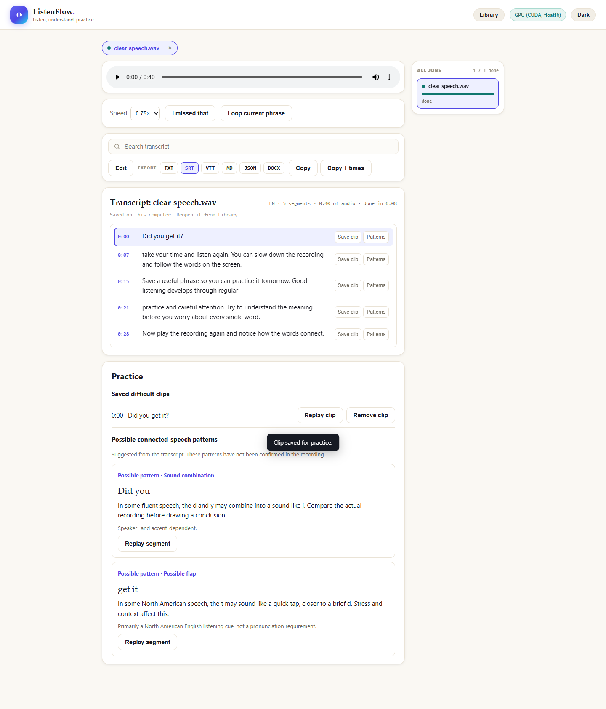

# ListenFlow

[](https://github.com/Xin-Chen-Max/ListenFlow/actions/workflows/ci.yml)

A local English listening workspace. Transcribe a recording on your computer, follow the words during playback, and replay the parts you missed.



## What it does

- Keeps recordings and transcripts in a searchable library across restarts.
- Highlights words during playback and lets you click the transcript to seek.
- Offers playback speed, sentence loops, and **I missed that** to replay the current or preceding sentence.
- Saves difficult clips for another listening session.
- Preserves transcript corrections in TXT and SRT exports.
- Shows brief dictionary-based speech cues below each sentence: linking IPA, weak forms and possible omitted sounds. Select a cue for explanations and replay.
- Retains audio after a failed job so transcription can be retried without another upload.

Recordings stay on the computer until explicitly deleted. Whisper models download on first use; transcription runs locally afterward.

## Work added for ListenFlow

ListenFlow extends [SFX-TECH/local-transcriber](https://github.com/SFX-TECH/local-transcriber). The upstream application supplies the transcription engine, base interface, word highlighting, and export support.

The ListenFlow work adds retained media and restart recovery, saved edits, learning controls, difficult-clip storage, and regression tests for those workflows. Backend additions also include resumable uploads with committed offsets and idempotent finalization. The [implementation notes](docs/architecture.md) describe the storage and recovery decisions. [UPSTREAM.md](UPSTREAM.md) records the foundation and contribution boundary.

## Run on Windows

Install Python 3.12 and FFmpeg/FFprobe, then extract the source into a writable folder. Double-click **setup.bat** for CPU setup, or run `.\setup.bat gpu` to install the NVIDIA runtime wheels. Then double-click **run.bat**. The browser opens once the local server is ready.

For a terminal session:

```powershell
.\setup.bat
.\run.bat
```

Open [127.0.0.1:8765](http://127.0.0.1:8765), choose a recording and start transcription. The default model is small; tiny is useful for a short first test. Each model downloads on first use. Keep one server process running for the library, and press Ctrl+C in its window to stop it.

See [Windows setup](docs/setup.md) for prerequisites, manual commands, GPU setup and troubleshooting. Transcription uses the visitor's own computer; there is no hosted transcription service.

## Verification

```powershell
.venv\Scripts\python.exe -m pip install -r requirements-dev.txt
.venv\Scripts\python.exe -m pytest tests -q
```

The regression tests use isolated storage. Browser acceptance covers actual transcription, synchronized playback, saved edits, a full server restart, and deletion. A separate RTX 5090 check used CUDA/float16 with the tiny model: a 40-second synthetic English clip took 3.39 seconds in the 2026-10-24 run. This measures one fixture and setup, not general transcription accuracy. See [validation](docs/validation.md) for context and reproduction.

## Scope and limitations

This version is a personal desktop application. Android delivery and private phone access have not completed device acceptance. Public hosting and multi-user operation are outside the supported scope.

Connected-speech suggestions are labelled **Possible pattern**. Six generic rule families use the bundled CMU US English dictionary, including pronunciation alternatives. Conditional opportunities disclose context and stress assumptions. Cues are illustrative, and none has been confirmed in the audio. Long recordings load nearby summaries and cache details on demand. See [speech opportunities](docs/speech-opportunities.md) for supported rules and limits. Editing a segment clears its old word alignment; playback then uses segment timing.

The patched desktop environment passed its current known-vulnerability audit. Keep the application bound to loopback; [security notes](SECURITY.md) describe the audit scope and deployment boundary. Installation, regression tests and CPU transcription passed on a fresh GitHub-hosted Windows runner. See the [validation record](docs/validation.md).

## License

MIT. The original copyright and license are retained in [LICENSE](LICENSE). The upstream application was created by Jesse Jolly (SFX Tech Innovation).

The bundled CMU dictionary has its own [original license](pronunciation/data/cmudict/LICENSE) and [pinned provenance](pronunciation/data/cmudict/PROVENANCE.md).
