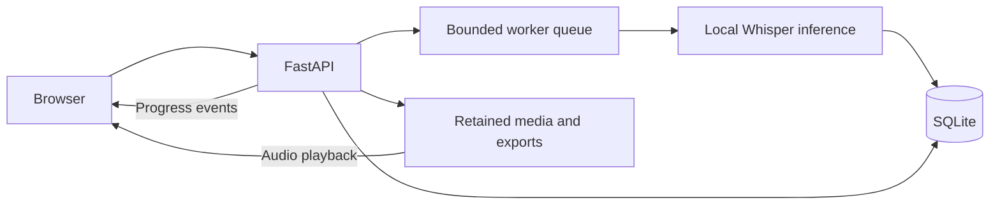

# Implementation Notes

The supported entrypoint is `app:app`, served by one Uvicorn process on loopback. The browser uses plain JavaScript, HTML and CSS. The backend uses FastAPI, SQLite, and the upstream FFmpeg/faster-whisper pipeline.

## Recording lifecycle

An upload gets a generated ID and its own source directory. Display filenames cannot choose storage paths. SQLite stores recording metadata, transcript segments, state and saved clips. Audio remains available after transcription and failed jobs.

The worker advances a job from queued to running, then done or error. At startup, queued or running entries from a previous process become interrupted errors. Retrying is explicit so a restart does not silently begin expensive inference. A library-specific OS lock prevents a second application process from changing another process's active jobs.

Deleting a saved recording removes its source, exports, transcript and clips. Active jobs cannot be deleted. Windows file locks are retried briefly; a persistent lock produces an error instead of a false success.

## Edits and practice

The reading view shows brief IPA cues beneath punctuation-delimited sentences, with local expandable explanations. Editable/searchable text remains separate so annotations cannot enter transcripts or exports. Historical items reuse library metadata. Viewport observation fetches 24-segment summaries; details fetch one segment on click and are cached by recording/revision. Responses update cue hosts and underline classes without replacing word nodes. Range analysis keeps neighboring context and global identities, with fingerprint guards and cancellation after edits. The default full endpoint remains compatible; see [API notes](api.md).

Saved edits keep segment times and remove word alignment from changed segments. Keeping the original word timings would highlight stale text. TXT/SRT exports use persisted corrections.

Sentence replay uses punctuation and aligned word times, with segment timing as a fallback. Smart Replay selects the preceding sentence near a new sentence's beginning. Difficult clips store segment intervals in SQLite. Connected-speech candidates are text rules with explicit uncertainty, not acoustic observations.

Speech opportunities use a separate pronunciation package: pinned CMU dictionary lookup, original-text/timing context, generic phone rules and a shared versioned result schema. Analysis runs off the API event loop and writes no new SQLite state. Fingerprints prevent old analysis from being displayed after text changes. Alignment and acoustic verification have separate future interfaces; neither is implemented as pronunciation verification. See [rule and data details](speech-opportunities.md).

## Resumable upload contract

The backend retains the resumable API for later clients. A persistent client UUID identifies an upload. Chunks are sequential and bounded to 8 MiB; the file limit defaults to 2 GiB. SQLite's committed offset is authoritative. File writes are flushed before committing a new offset, and status/retry truncates uncommitted tails.

Finalization uses a deterministic recording ID and one metadata transaction. A repeated completion response refers to the same job. Minimal tombstones prevent a deleted computer recording from being silently recreated. Inactive unfinished sessions expire after seven days when subsequent upload operations perform cleanup. See [API notes](api.md).

## Boundaries

The worker queue and live event buffers belong to one application process. SQLite and retained media supply durable state. This design supports a personal library, not a distributed service.

Local mode is the default. Private-mode middleware checks the configured owner and proxy origin before consuming bodies, but actual Tailscale/device acceptance remains incomplete. No remote access configuration is enabled by these setup instructions.
